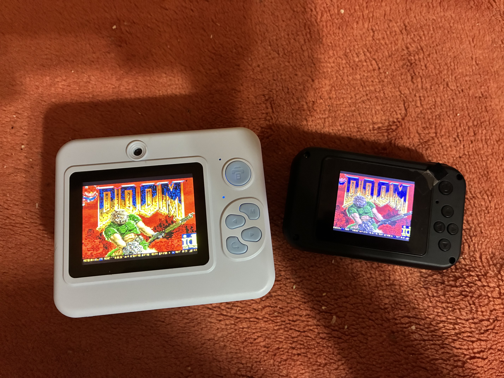
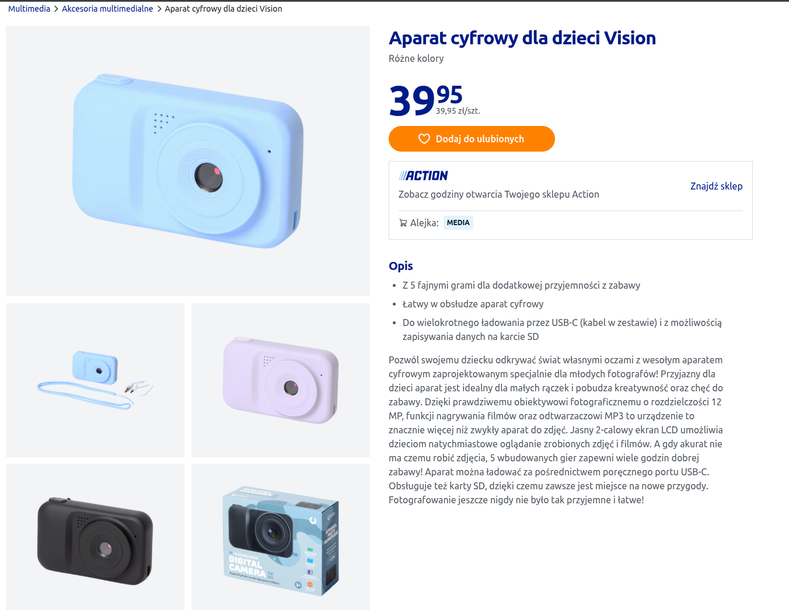
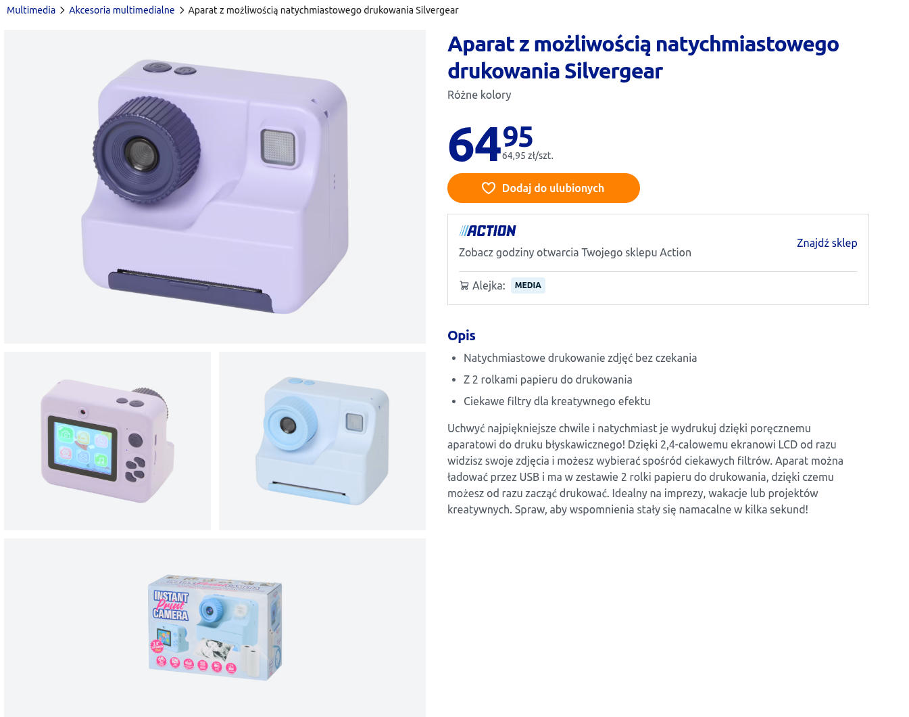
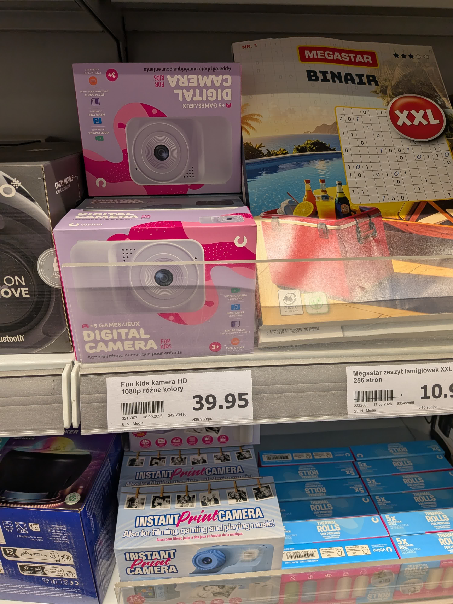
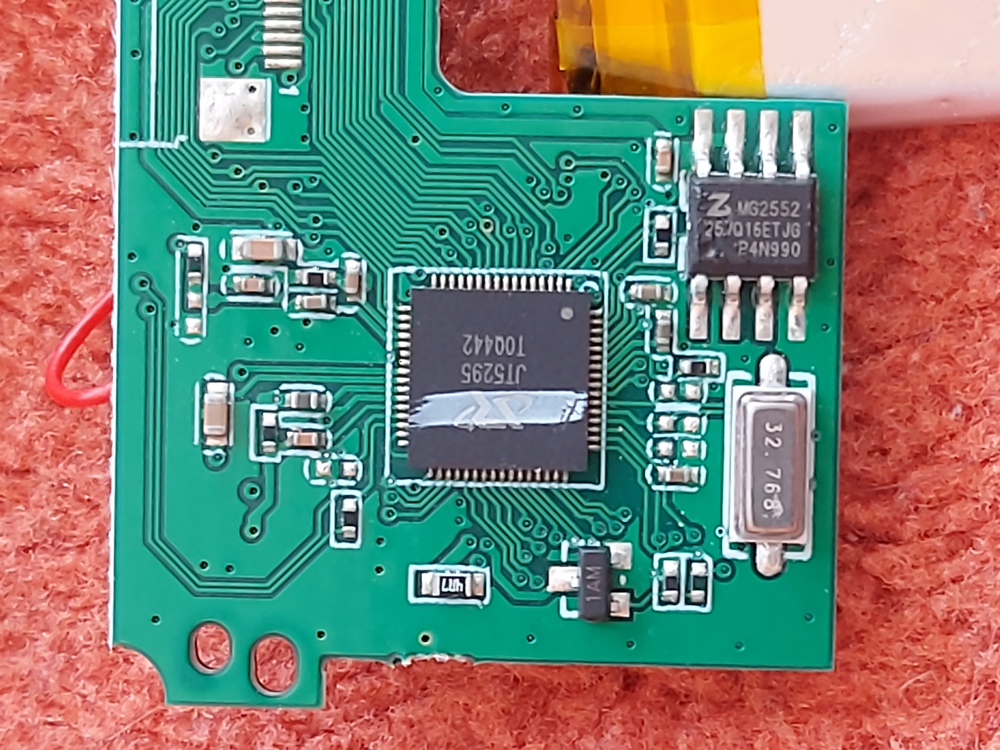
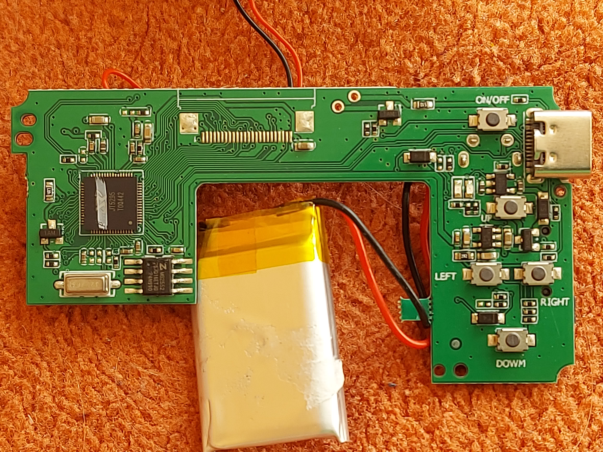
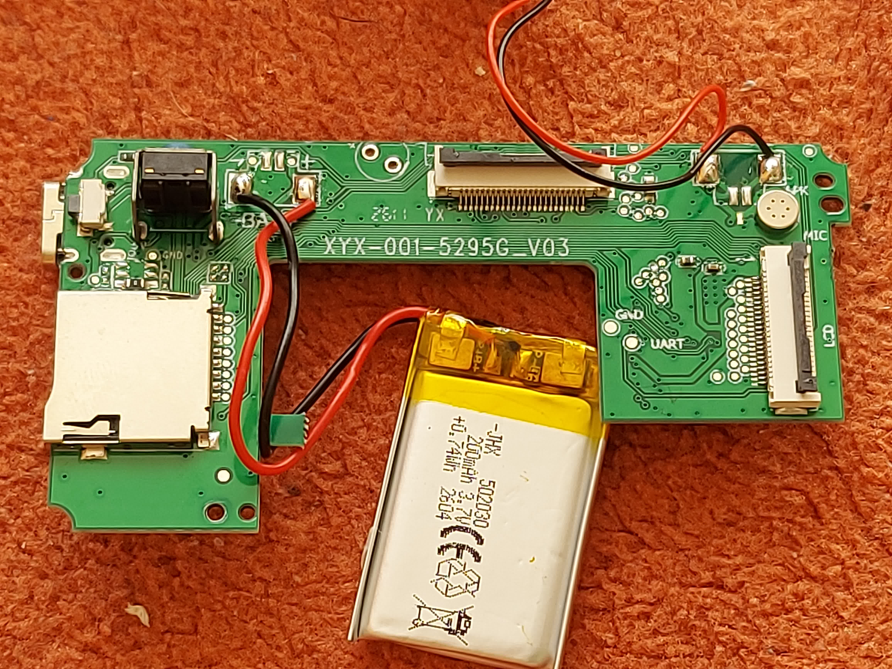
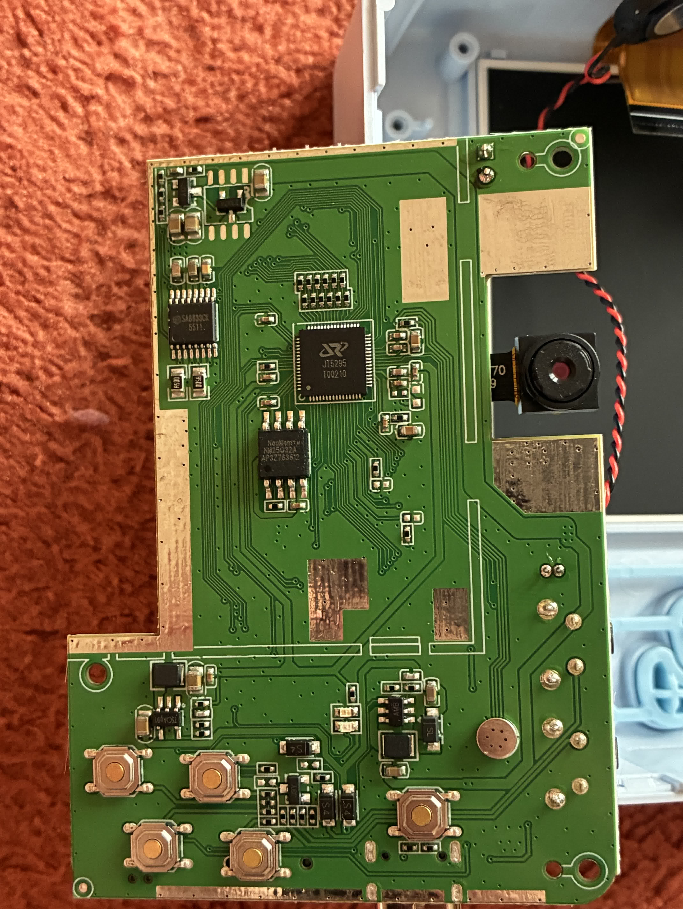
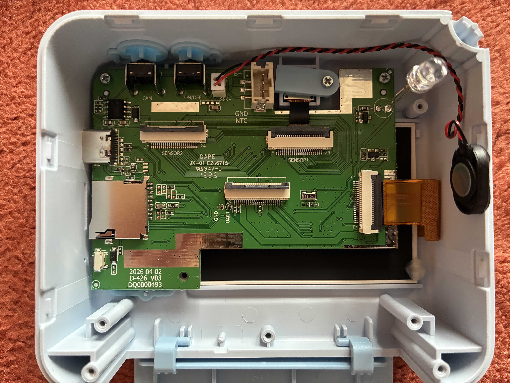
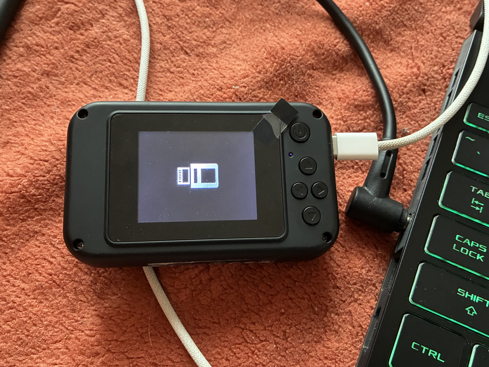

# DOOM on two Action digital camera's for kids



DOOM running on two cheap digital cameras for kids sold by the Dutch discounter Action. No hardware modifications - the
stock firmware is replaced over the USB port already on the board, and it can be put back the same way.

<!-- TODO: photo of the real device + video link

-->
<!-- TODO: CI badge and releawithses page, once the repository has a remote -->

Both are built around the same undocumented **JT5295** QFN64 SoC. There is no datasheet and no vendor documentation for
it. Everything in this repository - the register map, the display DMA path, the button ladder, the audio queue - was
reconstructed from the stock firmware and verified on the device, in the companion SDK this repository vendors
([`firmware/sdk`](firmware/sdk)). The BootROM protocol turned out to match AppoTech's "AX" command set, so the earlier
[reverse engineering write-up by a Russian blog](https://habr.com/ru/companies/ruvds/articles/779626/) is the reference for
reading and writing addresses and, importantly, executing code over USB. See [docs/SOC_IDENTIFICATION.md](docs/SOC_IDENTIFICATION.md).

## The two cameras

| | Vision | Silvergear (with built in thermal printer) |
|---|---|---|
| Shop | [article 3216907](https://www.action.com/pl-pl/p/3216907/aparat-cyfrowy-dla-dzieci-vision/) | [article 3222882](https://www.action.com/pl-pl/p/3222882/aparat-z-mozliwoscia-natychmiastowego-drukowania-silvergear/) |
| Price | PLN 39.95 | PLN 64.95 |
| Board | `XYX-001-5295C_V03` | `JX-01 E246715` |
| Buttons |  6 - UP, DOWN, LEFT, RIGHT, SHUTTER (camera/video button) and POWER |  7 - UP, DOWN, EXIT, MODE, SHUTTER (camera/video button), PRINT  and POWER |
| Stock firmware | AppoTech camera SDK build with a kids theme (`XYX-2M-NEW 0a39 9225=1 2.0`, `32895B_KIDS_CAM`) | AppoTech camera SDK build with a kids theme (`2026/04/20 16:22:35`, `329X_V1.0.0`) |
| Panel | 2" ILI9225G, 176x220 native, mounted landscape: 220x176 | 2.4" ST7789, 240x320 native, mounted landscape: 320x240 |
| Build | `make` | `make BOARD=silvergear-3222882` |

| | |
|---|---|
|  |  |



*Where it starts - the camera in different colours sitting on the same shelf.*

---

## What works

* DOOM (shareware **E1M1**) at the full 35 Hz game rate on both cameras: 30-35 frames per second in the start area, no dropped
  tics in a two-minute random-walk test (Vision); about 35 fps with the picture scaled up to the larger panel (Silvergear)
* **144 MHz** core clock, matching stock, with the caches on
* **Hardware multiply and divide.** The SDK's compiler profile uses software `mul`/`div`; the JT5295 has `l.mul`, `l.div` and
  `l.divu` (the stock firmware uses them), so [`firmware/sdk/src/hwmuldiv.S`](firmware/sdk/src/hwmuldiv.S) replaces libgcc's
  routines and `FixedMul` is built from four `l.mul`
* **Sound effects**, mixed in software and streamed to the DAC with the hardware's next-block queue, so blocks follow each
  other without a gap
* Every button, with a control scheme made for each pad: the Vision's five keys share one ADC ladder, the Silvergear's seven all do
  (see [Controls](#controls))
* **Silvergear: print the screen** on its built-in thermal printer with the PRINT key (see [Printing](#printing-silvergear))
* **Correct colours and orientation** from a cold start: the engine's 8-bit palette frame goes through two 256-entry lookup
  tables straight into the NV21 planes the display DMA wants, no RGB565 detour
* WAD from the **SD card**, sent **over USB** for development, or **packed inside the firmware image** when there is no card
* Flashing and full recovery over USB, no soldering or disassembly required (Vision; the Silvergear has to be opened once to force
  the BootROM, see [Flashing](#flashing))
* The USB stack is **TinyUSB** and the SD driver is the SDK's new one (high-speed mode, 4-bit where the board has the wires)

## What does not

* **No music.** DOOM's MUS lumps need a synthesizer; they are left out on purpose. Effects only.
* The screen wipe looks wrong (front and back buffer share memory).
* Only one map: the WAD is trimmed to E1M1 plus what the menus need (1.48 MB), see [wad/README.md](wad/README.md).
* The SD card is only *read*. Nothing in this project writes to it.
* The Silvergear's cold-boot image has been tested on one camera only (WAD from flash, no SD card); the Vision's has not been cold-booted since
  the SDK update (see [docs/FLASHING.md](docs/FLASHING.md)).
* Printing stops the game for about 15 seconds, and it is slower than the stock firmware's print (see [Printing](#printing-silvergear)).

---

## The SoC, shared by both



*The JT5295 QFN64 and the 25Q16 flash next to it.*

| | |
|---|---|
| Core | **OpenRISC** ORBIS32, little endian, **no branch delay slots** (a taken jump skips the next instruction), calls link to PC+4. Needs a patched GCC, see [docs/TOOLCHAIN.md](docs/TOOLCHAIN.md) |
| RAM | 4 MiB DDR at `0x02000000`, cached |
| Flash | 25Q16 (JEDEC `5E4015`), 2 MiB on the Vision; 4 MiB (JEDEC `944016`) on the Silvergear. **Not memory mapped**: the BootROM copies one block into RAM, everything runs from RAM |
| BootROM | 64 KB on chip, speaks AppoTech's USB SCSI command set; forces a recovery mode (`1908:3319`) if the flash is bad |
| Clock | ~96 MHz from the loader, **144 MHz** after the SDK's PLL switch (inferred from a 32.768 kHz crystal reference) |
| Display | ILI9225G (Vision) or ST7789 (Silvergear), fed NV21 planes by DMA (the Vision through a YUV-to-RGB compositor) |
| SD | SD controller, 24 MHz, high-speed mode; the SDK probes 4-bit on the Vision and falls back to 1-bit. The Silvergear stays 1-bit: DAT1-3 would be the printer motor and camera power pins |
| Audio | 16-bit DAC with a DMA that has a one-deep "next block" queue |
| Power | rechargeable 200 mAh battery behind a power-management chip that needs a stock sequence on every cold boot |

The chip is *not* an STM32 or an ACM32 (that was the other console's SoC); nothing in an ARM SDK applies. Full details in
[docs/HARDWARE.md](docs/HARDWARE.md).

---

## Controls

### Vision




Five of the six buttons (SHUTTER, UP, DOWN, LEFT, RIGHT) sit on **one resistor ladder** read through an ADC, so only one of
them can be seen at a time. POWER is a separate digital input and can be combined with one of them.

| Press | Does |
|---|---|
| UP / DOWN | walk forward / back (menus: move) |
| LEFT / RIGHT | turn (menus: change value) |
| SHUTTER | fire |
| POWER, tap | use / open doors / menu "enter" |
| POWER + LEFT / RIGHT | strafe |
| POWER + UP / DOWN | next / previous weapon |
| POWER, hold 0.65 s | menu |
| POWER, hold 3 s | power the camera off |

You cannot walk and fire, or walk and turn, at the same instant: the pad cannot report it. (Whether the ladder gives distinct
values for two keys at once has not been measured yet; `doom-probe` in the SDK logs the raw ADC value for exactly that.)

### Silvergear




All seven keys, **POWER included**, sit on one ladder, so exactly one key is seen at a time and POWER cannot be a modifier. There is
no UP or DOWN. That leaves no way to walk backwards, strafe, or pick a weapon by direction; the next weapon is a POWER tap.

| Key | In the game | In a menu or message |
|---|---|---|
| LEFT / RIGHT | turn left / right | up / down |
| EXIT (hold) | walk forward | back (closes the menu) |
| MODE | use / open doors | value + |
| SHUTTER | fire | enter |
| PRINT | **print the screen** (see below) | value - |
| POWER, tap | next weapon | - |
| POWER, hold 0.65 s | menu | |
| POWER, hold 3 s | power the camera off (after you let go) | |

What a key means is decided when it goes down and kept until it is released, so the EXIT that closes a menu does not turn into a
walk forward the moment the menu is gone.

---

## Printing (Silvergear)

The Silvergear has a thermal printer (384 dots wide). **PRINT** in the game prints what is on the screen as a sticker:

1. The frame is captured (the HUD and any message are part of it; PRINT does nothing inside a menu).
2. The game stops and a box says `PRINTING...  EXIT CANCELS`. EXIT cancels the job; a paper-out, an overheated head or a low battery
   ends it with a message (`NO PAPER`, `HEAD TOO HOT`, `BATTERY LOW`) instead of failing silently.
3. The image, 3:2 landscape, is rotated and scaled to fill the head: 384 x 576 dots, the long side along the paper. It takes about
   15 seconds (the stock firmware's own print is faster, about 10 s: the SDK driver spends roughly 14 ms per half-row on heating and on
   preparing the next one, stock 8.3 ms).
4. `PRINT FINISHED` - tear the sticker off. The game clock is resynchronised and the sound comes back; nothing runs on "while you were
   printing".

The box is drawn once, before the head starts, and **not updated while it runs**. The first version showed a progress bar; refreshing the
screen stalled the printer's next step for up to 36 ms about every 250 ms and every stall left a visible stripe. The printer log line
(`print steps: ... histogram`, see `apxtool debug logs`) shows how many half-rows fell into each period bin; a clean print has nothing
above 18 ms. The code is [`firmware/port/doom_print.c`](firmware/port/doom_print.c), on top of the SDK's printer driver (Gray mode).

---

## Building

Needs the patched OpenRISC toolchain (`or1k-appotech-elf-gcc`, GCC 16.2.1 + binutils 2.47 + picolibc 1.8.12) and `make`,
`python3` with `pyelftools`, `pyusb` and `Pillow` for the tools. [docs/TOOLCHAIN.md](docs/TOOLCHAIN.md) says how to build the
toolchain from the pinned sources; the Makefile looks for it in `toolchain/install`.

```sh
cd firmware
make                                   # Vision:     build/doom.elf + build/doom.manifest.json
make BOARD=silvergear-3222882          # Silvergear: build/silvergear-3222882/doom.elf + doom.manifest.json
make DOOM_STATS=0                      # no stats line, no host key hook
make clean [BOARD=...]
```

The image is a single GBADoom engine overlay (~660 KB) plus the SDK's runtime window (~100 KB, with TinyUSB). On the Silvergear the
SDK's printer and peripheral code does not fit the runtime window and sits in the extra RAM bank (`EXTRA_CODE=1`, the default for that
board); the Vision keeps everything in the runtime window so that its SPI image stays small. The DOOM-specific board constants (panel,
scaling, text layout, button timing, print on/off) are in `firmware/boards/<board>/doom_board.h`; the SDK's own board file is
`firmware/sdk/boards/<board>/board.h` (a different name on purpose: both are on the include path).

The WAD is built from the reference port's processed E1M1 WAD with [`tools/wad_trim.py`](tools/wad_trim.py); the result,
`wad/doom1_e1m1.wad`, is in the repository.

---

## Flashing 

> [!NOTE]
> The quick flash guide assumes the Vision camera,
> dissassembly is required for the Silvergear camera to force it into BootROM mode; in the stock firmware the camera will not accept entering into MSC mode 
> for the BootROM entrypoint as it will shut off immediately and refuse to power on when USB power is present.
> See [FLASHING.md](docs/FLASHING.md) for more details. 

### 1. Plug the camera into a computer

Any USB data cable. Plugging in a powered-on camera puts the stock firmware into mass-storage mode, which accepts the vendor
commands that enter the BootROM loader.



### 2. Run it from RAM (nothing is written to flash)

```sh
tools/launch.sh --reclaim-jpeg-ram     # Vision from stock firmware; launches firmware/build/doom.manifest.json
tools/load_wad.py wad/doom1_e1m1.wad   # development shortcut: send the WAD over USB instead of using an SD card
```

`--reclaim-jpeg-ram` is needed when the camera still runs its stock firmware: the engine goes where the stock firmware keeps data, and
the launcher refuses to overwrite it unless you ask (it saves that RAM to a `jpeg-ram-before-*.bin` file first). It is not needed when the
camera already runs an SDK image.

For the **Silvergear**, build it with `make BOARD=silvergear-3222882` and launch it with `BOARD=silvergear-3222882 tools/launch.sh` (see
[docs/FLASHING.md](docs/FLASHING.md) for getting it into the loader). With **more than one camera** plugged in the script does not guess:
name the USB port, `USB_PORT=5-1 BOARD=silvergear-3222882 tools/launch.sh` (`lsusb -t` shows it). The other tools take `--port` and,
for the ones that read the build's ELF, `--board silvergear-3222882`.

Power-cycle the camera to get the old firmware back. For the SD card, copy `wad/doom1_e1m1.wad` to the **root of the card as
`DOOM.WAD`** (FAT or exFAT).

### 3. Make it permanent (optional)

```sh
python3 tools/spi_pack.py --original dumps/flash.bin --manifest firmware/build/doom.manifest.json \
        --wad wad/doom1_e1m1.wad --output build-spi/doom.spi.bin
tools/install.sh build-spi/doom.spi.bin
```

`install.sh` launches the flash driver over USB, **reads the whole chip into a backup first**, and only writes after you type
`install`. **Read [docs/FLASHING.md](docs/FLASHING.md) before you do this**, especially the part about getting back.

> [!WARNING]
> The Vision image is built on the new SDK (TinyUSB, new SD driver) and **has not been cold-booted on a Vision yet**. The SDK itself has
> run TinyUSB images from RAM on the Vision but has never cold-booted one from SPI there (it has on the Silvergear). The USB start-up
> sequence is the same as the old driver's, and a camera that does not start is recoverable (see FLASHING.md), but take the backup and
> keep the BootROM method in mind.

For the **Silvergear** use its own script (it reads the whole 4 MiB chip twice, packs the image on top of that read, shows the hashes and
asks before it writes). The camera has to be running an SDK image on USB (a DOOM launched with `tools/launch.sh` is one):

```sh
make -C firmware BOARD=silvergear-3222882
USB_PORT=5-1 tools/install_silvergear.sh
```

---

## Repository layout

```
firmware/          the DOOM firmware, standalone build
  boards/          per-board constants (doom_board.h: panel, scaling, text layout, WAD path, button timing)
    action-vision/
    silvergear-3222882/
  sdk/             the JT5295 SDK (MIT, vendored, see sdk/README.md): runtime, TinyUSB, display, SD, audio, buttons, SPI, printer
  port/            GBADoom's platform layer: video, time, per-board input (input_*.c), sound mixer, WAD loading, printing
  GBADoom/         vendored engine + engine-patches.diff
  linker/          the memory map
toolchain/         build script + patches for the OpenRISC GCC / binutils / picolibc
tools/             launch / install / rescue scripts, the vendored apxtool host library (python/, see python/VENDORED.md) and the SPI flasher payload (flasher/),
                   WAD trimmer, screenshot and key-injection helpers
wad/               trimmed shareware WAD
dumps/             stock firmware and BootROM
docs/              hardware notes, SoC identification, flashing, toolchain and porting guides
images/            hardware photos, shop pages and screenshots
```

---

## Credits

* **[doomhack/GBADoom](https://github.com/doomhack/GBADoom)** - the DOOM engine this port is built on, itself based on
  prboom. Upstream commit `89097b3`. Nine files are changed (see
  [`firmware/GBADoom/engine-patches.diff`](firmware/GBADoom/engine-patches.diff)): the IWAD pointer, time base, hardware
  fixed-point multiply, a static zone, empty-lump diagnostics and a few things that only matter because the WAD holds a
  single map.
* **id Software** - DOOM. The WAD here is the freely redistributable shareware IWAD, trimmed to a single map. The DOOM source
  code is GPL v2.
* **[atc1441/TXW818_WalkieTalkie_Doom](https://github.com/atc1441/TXW818_WalkieTalkie_Doom)** - reference for how to get
  GBADoom onto a small CPU with a tiny panel and a WAD that lives in RAM.
* **[atc1441/Action_104_Games_and_Pacman_DOOM](https://github.com/atc1441/Action_104_Games_and_Pacman_DOOM)** - inspiration
  for the folder structure, the documentation and most of the platform layer of a different device sold in the same Action
  stores.
* **[NordicPlayground/nrf-doom](https://github.com/NordicPlayground/nrf-doom)** - useful comparison for memory budgeting.
* The BootROM command set was first documented in the [Habr article](https://habr.com/ru/companies/ruvds/articles/779626/)
  about a different Buildwin children's camera.
* Product photos are screenshots from Action's own shop pages.

## Licence

GPL v2 for the DOOM image (`firmware/port`, `firmware/GBADoom`), inherited from GBADoom and the DOOM source release. The core
SDK (`firmware/sdk`) remains MIT so it can be reused in other projects. See [LICENSE](LICENSE).

The contents of `dumps/` are neither ours nor GPL - they are the vendor's stock firmware, included so the reverse engineering
can be checked. See [dumps/README.md](dumps/README.md).

## Disclaimer

This overwrites the firmware of a device you bought. It is recoverable if you made the backup, and the BootROM can always be
reached with a screwdriver and a pair of tweezers. Nobody involved with Action or the manufacturer had anything to do with
this.
