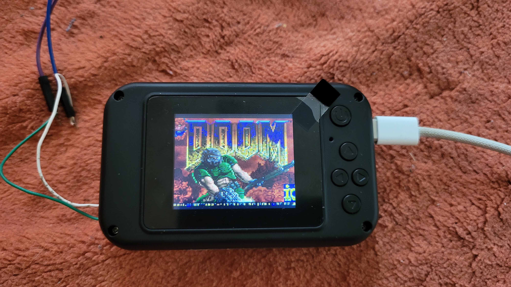
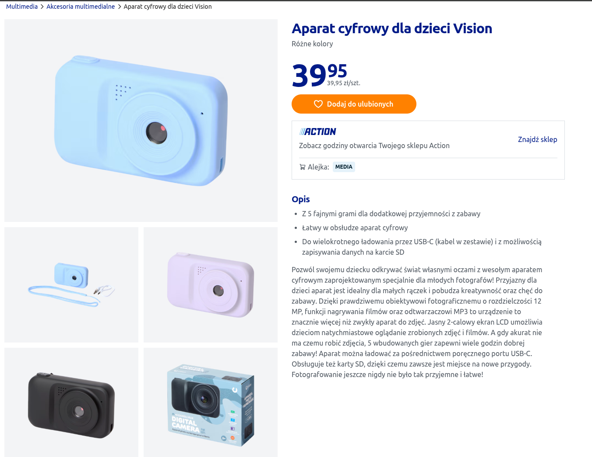
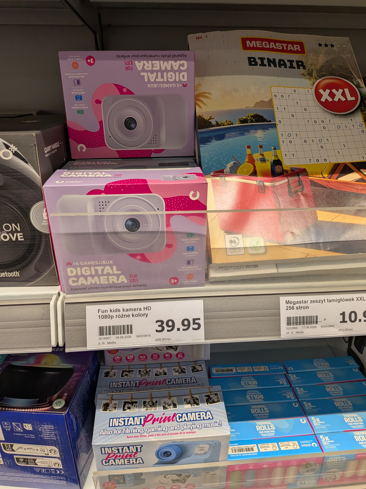
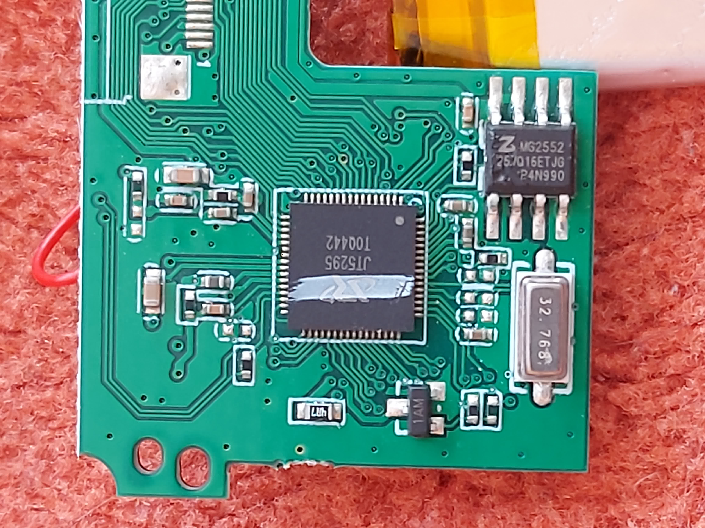
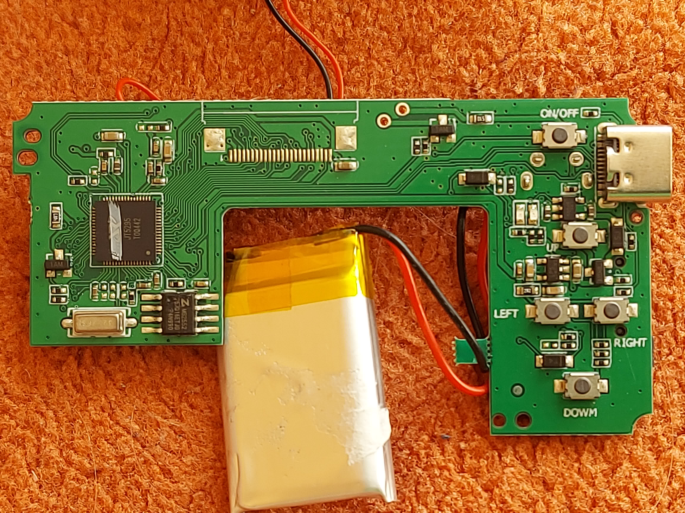
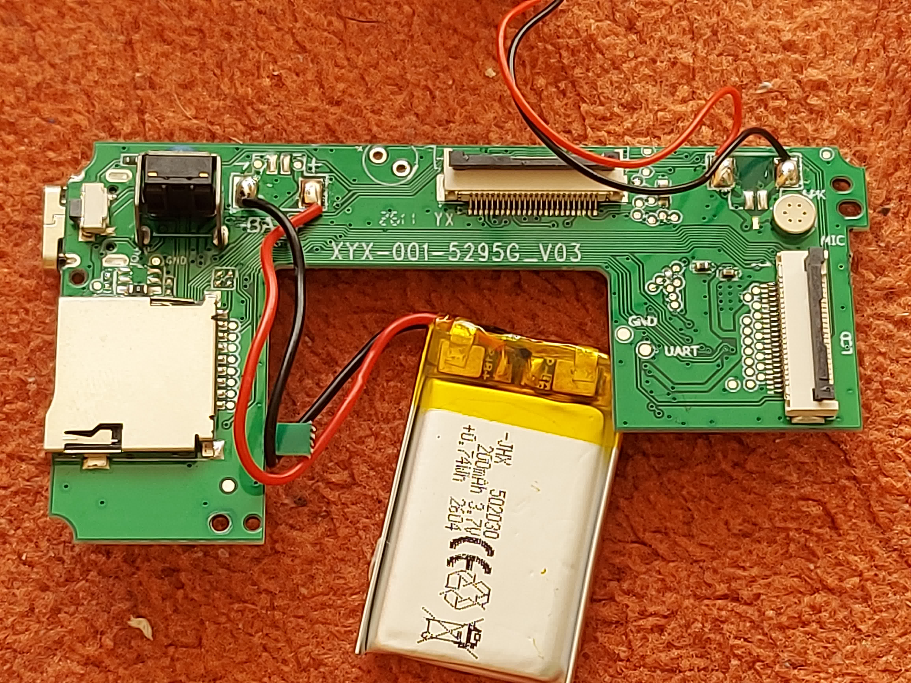
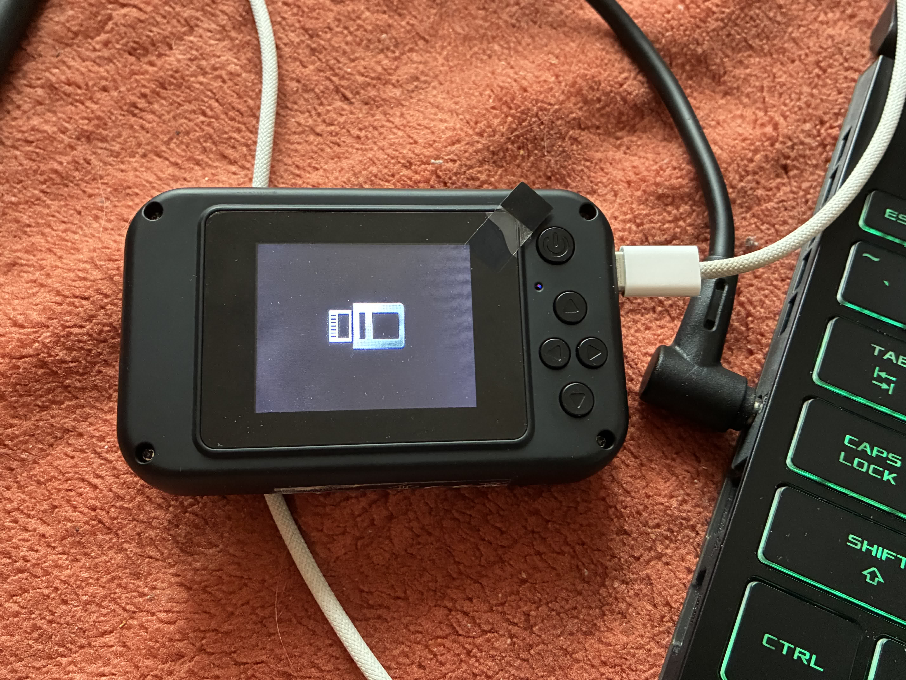

# DOOM on an Action digital camera for kids



DOOM running on a cheap digital camera for kids sold by the Dutch discounter Action. No hardware modifications - the
stock firmware is replaced over the USB port already on the board, and it can be put back the same way.

<!-- TODO: photo of the real device + video link

-->
<!-- TODO: CI badge and releawithses page, once the repository has a remote -->

This project is built around the undocumented **JT5295** QFN64 SoC. There is no datasheet and no vendor documentation for
it. Everything in this repository - the register map, the display DMA path, the button ladder, the audio queue - was
reconstructed from the stock firmware and verified on the device, in the companion SDK this repository vendors
([`firmware/sdk`](firmware/sdk)). The BootROM protocol turned out to match AppoTech's "AX" command set, so the earlier
[reverse engineering write-up by a Russian blog](https://habr.com/ru/companies/ruvds/articles/779626/) is the reference for
reading and writing addresses and, importantly, executing code over USB. See [docs/SOC_IDENTIFICATION.md](docs/SOC_IDENTIFICATION.md).

## The device

| | This device |
|---|---|
| Shop | [article 3216907](https://www.action.com/pl-pl/p/3216907/aparat-cyfrowy-dla-dzieci-vision/) |
| Price | PLN 39.95 |
| Board | `XYX-001-5295C_V03` |
| Buttons | 6 - UP, DOWN, LEFT, RIGHT, SHUTTER (camera/video button) and POWER |
| Stock firmware | AppoTech camera SDK build with a kids theme (`XYX-2M-NEW 0a39 9225=1 2.0`, `32895B_KIDS_CAM`) |
| Panel | 2" ILI9225G, 176x220 native, mounted landscape: 220x176 |





*Where it starts - the camera in different colours sitting on the same shelf.*

---

## What works

* DOOM (shareware **E1M1**) at the full 35 Hz game rate: 30-35 frames per second in the start area, no dropped tics in a
  two-minute random-walk test
* **144 MHz** core clock, matching stock, with the caches on
* **Hardware multiply and divide.** The SDK's compiler profile uses software `mul`/`div`; the JT5295 has `l.mul`, `l.div` and
  `l.divu` (the stock firmware uses them), so [`firmware/sdk/src/hwmuldiv.S`](firmware/sdk/src/hwmuldiv.S) replaces libgcc's
  routines and `FixedMul` is built from four `l.mul`
* **Sound effects**, mixed in software and streamed to the DAC with the hardware's next-block queue, so blocks follow each
  other without a gap
* Every button, with a control scheme made for a pad whose five keys share one ADC ladder (see [Controls](#controls))
* **Correct colours and orientation** from a cold start: the engine's 8-bit palette frame goes through two 256-entry lookup
  tables straight into the NV21 planes the display DMA wants, no RGB565 detour
* WAD from the **SD card**, or **packed inside the firmware image** when there is no card
* Flashing and full recovery over USB, no soldering or disassembly required

## What does not

* **No music.** DOOM's MUS lumps need a synthesizer; they are left out on purpose. Effects only.
* The screen wipe looks wrong (front and back buffer share memory).
* Only one map: the WAD is trimmed to E1M1 plus what the menus need (1.48 MB), see [wad/README.md](wad/README.md).
* The SD card is only *read*. Nothing in this project writes to it.

---

## The SoC



*The JT5295 QFN64 and the 25Q16 flash next to it.*

| | |
|---|---|
| Core | **OpenRISC** ORBIS32, little endian, **no branch delay slots** (a taken jump skips the next instruction), calls link to PC+4. Needs a patched GCC, see [docs/TOOLCHAIN.md](docs/TOOLCHAIN.md) |
| RAM | 4 MiB DDR at `0x02000000`, cached |
| Flash | 25Q16 (JEDEC `5E4015`), 2 MiB, **not memory mapped**: the BootROM copies one block into RAM, everything runs from RAM |
| BootROM | 64 KB on chip, speaks AppoTech's USB SCSI command set; forces a recovery mode (`1908:3319`) if the flash is bad |
| Clock | ~96 MHz from the loader, **144 MHz** after the SDK's PLL switch (inferred from a 32.768 kHz crystal reference) |
| Display | ILI9225G, driven through a YUV-to-RGB compositor and an LCD DMA engine |
| SD | 1-bit SD controller, 24 MHz |
| Audio | 16-bit DAC with a DMA that has a one-deep "next block" queue |
| Power | rechargeable 200 mAh battery behind a power-management chip that needs a stock sequence on every cold boot |

The chip is *not* an STM32 or an ACM32 (that was the other console's SoC); nothing in an ARM SDK applies. Full details in
[docs/HARDWARE.md](docs/HARDWARE.md).

---

## Controls





Five of the six buttons (SHUTTER, UP, DOWN, LEFT, RIGHT) sit on **one resistor ladder** read through an ADC, so only one of
them can be seen at a time. POWER is a separate digital input and can be combined with one of them.

| Press | Does |
|---|---|
| UP / DOWN | walk forward / back (menus: move) |
| LEFT / RIGHT | turn (menus: change value) |
| SHUTTER | fire |
| POWER, tap | use / open doors / menu "enter" |
| POWER + LEFT / RIGHT | strafe |
| POWER + UP / DOWN | next / previous weapon |
| POWER, hold 0.65 s | menu |
| POWER, hold 3 s | power the camera off |

You cannot walk and fire, or walk and turn, at the same instant: the pad cannot report it. (Whether the ladder gives distinct
values for two keys at once has not been measured yet; `doom-probe` in the SDK logs the raw ADC value for exactly that.)

---

## Building

Needs the patched OpenRISC toolchain (`or1k-appotech-elf-gcc`, GCC 16.2.1 + binutils 2.47 + picolibc 1.8.12) and `make`,
`python3` with `pyelftools`, `pyusb` and `Pillow` for the tools. [docs/TOOLCHAIN.md](docs/TOOLCHAIN.md) says how to build the
toolchain from the pinned sources; the Makefile looks for it in `toolchain/install`.

```sh
cd firmware
make                       # -> build/doom.elf + build/doom.manifest.json
make DOOM_STATS=0          # no stats line, no host key hook
```

The image is a single GBADoom engine overlay (~660 KB) plus a small runtime window (~80 KB). Board specifics live in
[`firmware/boards/action-camera/board.h`](firmware/boards/action-camera/board.h); the SDK's own board file is in
`firmware/sdk/board/board.h`.

The WAD is built from the reference port's processed E1M1 WAD with [`tools/wad_trim.py`](tools/wad_trim.py); the result,
`wad/doom1_e1m1.wad`, is in the repository.

---

## Running

### 1. Plug the camera into a computer

Any USB data cable. Plugging in a powered-on camera puts the stock firmware into mass-storage mode, which accepts the vendor
commands that enter the BootROM loader.



### 2. Run it from RAM (nothing is written to flash)

```sh
tools/launch.sh                        # builds nothing; launches firmware/build/doom.manifest.json
tools/load_wad.py wad/doom1_e1m1.wad   # development shortcut: send the WAD over USB instead of using an SD card
```

Power-cycle the camera to get the old firmware back. For the SD card, copy `wad/doom1_e1m1.wad` to the **root of the card as
`DOOM.WAD`** (FAT or exFAT).

### 3. Make it permanent (optional)

```sh
python3 tools/spi_pack.py --original dumps/flash.bin --manifest firmware/build/doom.manifest.json \
        --wad wad/doom1_e1m1.wad --output build-spi/doom.spi.bin
tools/install.sh build-spi/doom.spi.bin
```

`install.sh` launches the flash driver over USB, **reads the whole chip into a backup first**, and only writes after you type
`install`. **Read [docs/FLASHING.md](docs/FLASHING.md) before you do this**, especially the part about getting back.

---

## Repository layout

```
firmware/          the DOOM firmware, standalone build
  boards/          board constants (panel, crop, WAD path, button timing)
    action-camera/
  sdk/             the JT5295 SDK (MIT): runtime, USB debug link, display, SD, audio, buttons, SPI
  port/            GBADoom's platform layer: video, time, input, sound mixer, WAD loading, hardware mul/div
  GBADoom/         vendored engine + engine-patches.diff
  linker/          the memory map
toolchain/         build script + patches for the OpenRISC GCC / binutils / picolibc
tools/             launch / install / rescue scripts, the apxtool host library, WAD trimmer, screenshot and key-injection helpers
wad/               trimmed shareware WAD
dumps/             stock firmware and BootROM
docs/              hardware notes, SoC identification, flashing, toolchain and porting guides
images/            hardware photos, shop pages and screenshots
```

---

## Credits

* **[doomhack/GBADoom](https://github.com/doomhack/GBADoom)** - the DOOM engine this port is built on, itself based on
  prboom. Upstream commit `89097b3`. Nine files are changed (see
  [`firmware/GBADoom/engine-patches.diff`](firmware/GBADoom/engine-patches.diff)): the IWAD pointer, time base, hardware
  fixed-point multiply, a static zone, empty-lump diagnostics and a few things that only matter because the WAD holds a
  single map.
* **id Software** - DOOM. The WAD here is the freely redistributable shareware IWAD, trimmed to a single map. The DOOM source
  code is GPL v2.
* **[atc1441/TXW818_WalkieTalkie_Doom](https://github.com/atc1441/TXW818_WalkieTalkie_Doom)** - reference for how to get
  GBADoom onto a small CPU with a tiny panel and a WAD that lives in RAM.
* **[atc1441/Action_104_Games_and_Pacman_DOOM](https://github.com/atc1441/Action_104_Games_and_Pacman_DOOM)** - inspiration
  for the folder structure, the documentation and most of the platform layer of a different device sold in the same Action
  stores.
* **[NordicPlayground/nrf-doom](https://github.com/NordicPlayground/nrf-doom)** - useful comparison for memory budgeting.
* The BootROM command set was first documented in the [Habr article](https://habr.com/ru/companies/ruvds/articles/779626/)
  about a different Buildwin children's camera.
* Product photos are screenshots from Action's own shop pages.

## Licence

GPL v2 for the DOOM image (`firmware/port`, `firmware/GBADoom`), inherited from GBADoom and the DOOM source release. The core
SDK (`firmware/sdk`) remains MIT so it can be reused in other projects. See [LICENSE](LICENSE).

The contents of `dumps/` are neither ours nor GPL - they are the vendor's stock firmware, included so the reverse engineering
can be checked. See [dumps/README.md](dumps/README.md).

## Disclaimer

This overwrites the firmware of a device you bought. It is recoverable if you made the backup, and the BootROM can always be
reached with a screwdriver and a pair of tweezers. Nobody involved with Action or the manufacturer had anything to do with
this.
